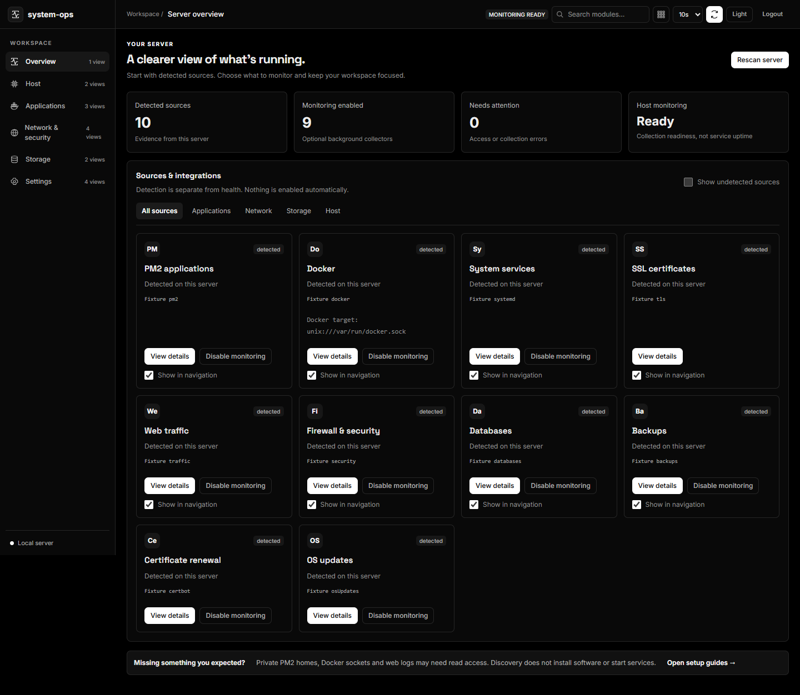

# System Ops

**A clearer view of your VPS.** Self-hosted operations console for a single Ubuntu host: resources, runtime inventory, logs, availability checks, and optional integrations in one place.

[Website](https://system-ops.dineshkorukonda.online/) · [Documentation](docs/README.md) · [Get started](docs/QUICKSTART.md) · [Support](SUPPORT.md) · [Contribute](CONTRIBUTING.md)

[](https://github.com/dineshkorukonda/system-ops/actions/workflows/ci.yml)
[](LICENSE)
[](package.json)



*Actual interface with demonstration data, not a production health or performance claim.*

## What you get

- **Host visibility:** resources, processes, systemd inventory/journals, storage, and TLS expiry.
- **Runtime monitoring:** optional PM2, Docker, Ollama, and database health views; detection and permissions remain visible.
- **Traffic and backups:** bounded Nginx analytics, optional GeoIP enrichment, configured backup files/logs.
- **Checks and alerts:** HTTP/TCP/external observations, persisted incidents/history, webhook delivery, and protected Prometheus metrics.
- **Operator workflow:** detected sources, optional monitoring, diagnostics, themes, and staged native updates with readiness-gated rollback.

Integration availability depends on your host and configuration. The console uses a shared administrator password. Backup listings do not prove restorability, and local checks cannot observe a complete outage of their own host. Resource use depends on enabled integrations; see [reproducible measurements](docs/RESOURCE-BASELINE.md).

## Get started

Native Ubuntu/systemd is the primary host-monitoring deployment. The installer needs administrator access and an interactive terminal, installs Node.js 24, and configures the service account and selected read permissions. Review it before execution:

```bash
curl -fsSL https://raw.githubusercontent.com/dineshkorukonda/system-ops/main/scripts/install.sh -o /tmp/system-ops-install.sh
less /tmp/system-ops-install.sh
sudo bash /tmp/system-ops-install.sh
```

The console binds to `127.0.0.1:9080` by default. Use an SSH tunnel or configure an HTTPS hostname. Follow the [quick start](docs/QUICKSTART.md) for access and verification.

### Docker

```bash
cp .env.docker.example .env.docker
# Set APP_PASSWORD, a random SESSION_SECRET of at least 32 bytes, and mounted paths.
docker compose --env-file .env.docker up -d --build
```

Docker includes the built UI and persistent data volume, with narrower host visibility. Its process metrics describe container `/proc`; host systemd/security commands, the Go sidecar, and native self-update are unavailable by default. Socket mounts alone do not install a Docker CLI. Read the [deployment comparison](docs/INSTALLATION.md).

## Update and recover

```bash
sudo bash /opt/system-ops/scripts/deploy.sh
sudo bash /opt/system-ops/scripts/recover.sh  # If an update needs recovery.
```

The native updater follows `main`. Settings → Update now uses a separate background worker where configured. Keep SSH access and data backups; see [updates and recovery](docs/UPDATES.md) and [release validation](docs/RELIABILITY-EVIDENCE.md).

## Development

Use Node.js 24.x. Linux is required for native host/deployment verification.

```bash
npm ci
cp .env.example .env  # Set APP_PASSWORD and SESSION_SECRET.
npm run build
npm start             # http://127.0.0.1:9080
```

For checks and frontend hot reload, see [CONTRIBUTING.md](CONTRIBUTING.md). Build the public docs with `npm run docs:build`; preview with `npm run site:dev`. Source documentation lives in `docs/`, and the marketing site lives in `web/`.

## Community

Ask questions in [Discussions](https://github.com/dineshkorukonda/system-ops/discussions), report reproducible defects with the [issue forms](https://github.com/dineshkorukonda/system-ops/issues/new/choose), and report vulnerabilities [privately](SECURITY.md). Support is best effort. Contributions follow the [contribution guide](CONTRIBUTING.md), [Code of Conduct](CODE_OF_CONDUCT.md), and [governance policy](GOVERNANCE.md).

[Changelog](CHANGELOG.md) · [Reliability roadmap](https://github.com/dineshkorukonda/system-ops/issues/33) · [Third-party notices](THIRD_PARTY_NOTICES.md)

MIT © 2026 Dinesh Korukonda. Dependencies retain their own licenses. See [LICENSE](LICENSE).
